<p align="center">
  
</p>

<p align="center">
  <a href="LICENSE"></a>
  
  
</p>

A fork of [fast-jev-compaction](https://github.com/tamaratran/fast-jev-compaction) that scores with
[Kev](https://github.com/jaredpalmer/kev), an open model you host yourself on [Modal](https://modal.com).

## Quick start

You need Claude Code 2.1.274 or newer (desktop app or CLI) and a [Modal](https://modal.com) account.

1. **Deploy Kev** to Modal: [deploy/README.md](deploy/README.md).
2. **Install the plugin:**
   ```sh
   claude plugin marketplace add 1njx/fast-kev-compaction
   claude plugin install fast-kev-compaction@fast-kev-compaction
   ```
3. **Set the options** `baseUrl`, `apiKey` and `model`, and turn on function hooks in `~/.claude/settings.json`:
   ```json
   { "env": { "CLAUDE_CODE_ENABLE_FUNCTION_HOOKS": "1" } }
   ```
4. **Restart Claude** fully, then type `/kevcompact` in a chat that has some tool calls.

Step by step with troubleshooting: [docs/MANUAL_SETUP.md](docs/MANUAL_SETUP.md).
Or paste [docs/AGENT_PROMPT.md](docs/AGENT_PROMPT.md) into Claude, Codex or another coding agent and let it do the setup.

## Behavior

- `/kevcompact` wakes the server if needed and compacts with Kev. A plain `/compact` stays Claude Code's
  built-in summary, and so do subagent compactions.
- At `compactAtPercent` (60% by default) the plugin starts the same flow on its own, at most once every 10 minutes.
- A hook can run only about 10 seconds, so very long chats may fall back to the normal summary.
- The server sleeps 60 seconds after the last request. A cold start costs roughly $0.25 to $0.40 of GPU time, so set a
  $0 spend limit in Modal.

Options and client differences: [hooks/README.md](hooks/README.md).

## As a library

```sh
npm install fast-kev-compaction
```

```ts
import { compactMessages } from 'fast-kev-compaction';

const result = await compactMessages(transcript, { preserveRecentMessages: 4 });
console.log(result.messages, result.decisions, result.stats);
```

API and options: [docs/LIBRARY.md](docs/LIBRARY.md). How the scoring works: [docs/HOW_IT_WORKS.md](docs/HOW_IT_WORKS.md).

## Development

```sh
npm install
npm run typecheck
npm test
npm run validate:plugin
```

The unit tests use a fake model and make no network calls.

## Credits

- [fast-jev-compaction](https://github.com/tamaratran/fast-jev-compaction) by Tamara Tran
  ([@tamaratran](https://github.com/tamaratran)), MIT. The compaction library and the Claude Code hooks are theirs,
  and this fork keeps their history and license.
- [Kev](https://github.com/jaredpalmer/kev) by Jared Palmer. `deploy/kev_serve.py` is copied from it with a shorter
  idle timeout.
- Kev support, `/kevcompact`, the progress messages and CLI support by [@1njx](https://github.com/1njx).

Released under the [MIT license](LICENSE).
